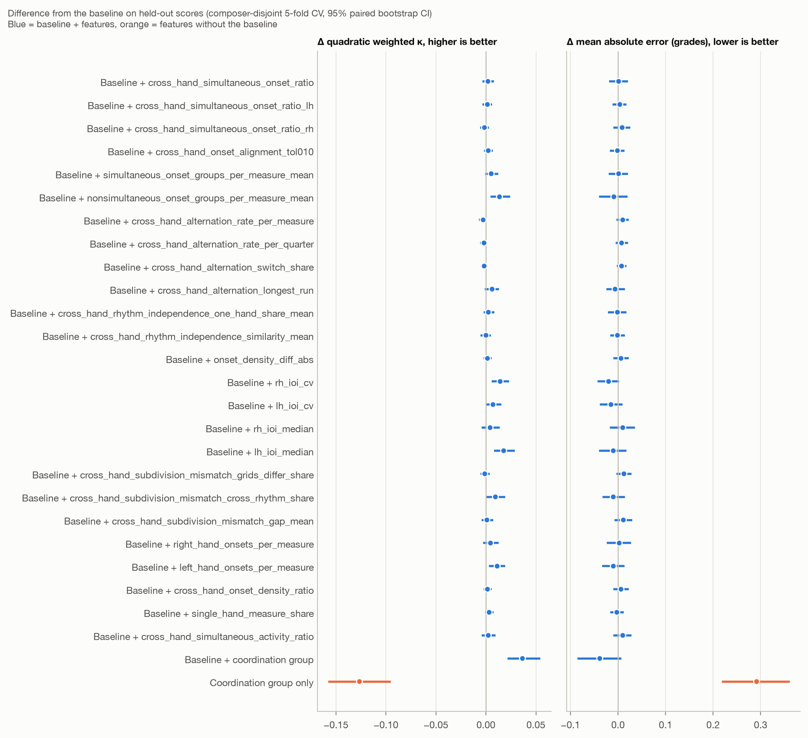
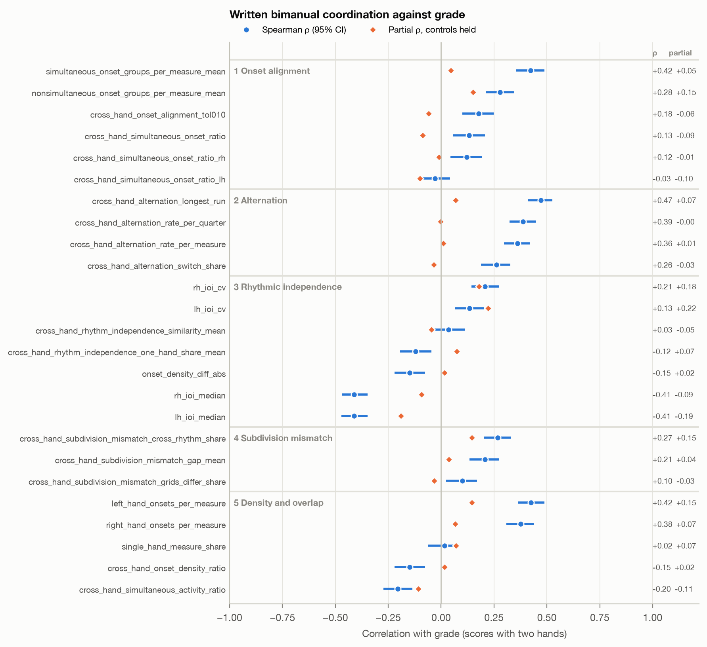

# Written bimanual coordination against grade

Generated by `nina_stats/coordination.py`: group A of `FEATURES_SPEC.md` (groups B–E are in `HAND_FEATURES.md`).
806 scores; hands from staves for 796, heuristic for 8, none for
2 (single staff; features missing). Per-measure table: `results/coordination_per_measure.csv`
(58053 measures). Of the measures where both hands play, 57% put the hands on
different subdivision grids and 1.4% on incompatible ones (e.g. triplets against 16ths).

## Incremental predictive value (FEATURES_SPEC.md §11)

Same set-up as `HAND_FEATURES.md`: ridge regression on quantile-normalised features, rounded to a grade,
**composer-disjoint** 5-fold CV, baseline = note count, notes per second, stored tempo, written duration and mean
polyphony; 95% bootstrap CIs on held-out scores, Δ paired against the baseline. Each named metric is added to the
baseline on its own, then the whole group (90 non-redundant features).

Baseline QWK 0.831. Whole coordination group: ΔQWK +0.037
[+0.022, +0.055], ΔMAE -0.038 [-0.086,
+0.007].

Single features whose ΔQWK interval excludes 0:

- lh_ioi_median: ΔQWK +0.018 [+0.008, +0.029], ΔMAE -0.010 [-0.040, +0.017]
- rh_ioi_cv: ΔQWK +0.014 [+0.006, +0.023], ΔMAE -0.020 [-0.043, +0.002]
- nonsimultaneous_onset_groups_per_measure_mean: ΔQWK +0.014 [+0.004, +0.024], ΔMAE -0.009 [-0.040, +0.020]
- left_hand_onsets_per_measure: ΔQWK +0.011 [+0.003, +0.019], ΔMAE -0.010 [-0.033, +0.014]

| Model | Features | QWK | Bal. acc9 | Acc ±1 | MAE | ΔQWK vs baseline | ΔMAE vs baseline |
|---|---|---|---|---|---|---|---|
| Baseline (5 controls) | 5 | 0.831 [0.808, 0.852] | 0.393 [0.354, 0.435] | 0.857 [0.833, 0.881] | 0.736 [0.680, 0.790] | – | – |
| Baseline + cross_hand_simultaneous_onset_ratio | 6 | 0.833 [0.811, 0.854] | 0.370 [0.335, 0.408] | 0.865 [0.841, 0.888] | 0.737 [0.684, 0.789] | +0.002 [-0.004, +0.008] | +0.001 [-0.019, +0.021] |
| Baseline + cross_hand_simultaneous_onset_ratio_lh | 6 | 0.833 [0.810, 0.853] | 0.381 [0.345, 0.419] | 0.867 [0.844, 0.888] | 0.739 [0.687, 0.792] | +0.001 [-0.003, +0.006] | +0.004 [-0.011, +0.017] |
| Baseline + cross_hand_simultaneous_onset_ratio_rh | 6 | 0.830 [0.807, 0.851] | 0.365 [0.330, 0.402] | 0.865 [0.842, 0.887] | 0.744 [0.694, 0.799] | -0.001 [-0.006, +0.003] | +0.009 [-0.010, +0.026] |
| Baseline + cross_hand_onset_alignment_tol010 | 6 | 0.833 [0.811, 0.854] | 0.377 [0.341, 0.418] | 0.866 [0.841, 0.888] | 0.734 [0.682, 0.789] | +0.002 [-0.002, +0.007] | -0.001 [-0.017, +0.014] |
| Baseline + simultaneous_onset_groups_per_measure_mean | 6 | 0.836 [0.814, 0.857] | 0.373 [0.336, 0.410] | 0.866 [0.842, 0.888] | 0.737 [0.686, 0.789] | +0.005 [-0.001, +0.012] | +0.001 [-0.020, +0.021] |
| Baseline + nonsimultaneous_onset_groups_per_measure_mean | 6 | 0.845 [0.825, 0.863] | 0.369 [0.332, 0.408] | 0.871 [0.847, 0.893] | 0.727 [0.674, 0.778] | +0.014 [+0.004, +0.024] | -0.009 [-0.040, +0.020] |
| Baseline + cross_hand_alternation_rate_per_measure | 6 | 0.828 [0.805, 0.849] | 0.375 [0.338, 0.412] | 0.861 [0.836, 0.883] | 0.746 [0.692, 0.800] | -0.003 [-0.007, +0.001] | +0.010 [-0.004, +0.022] |
| Baseline + cross_hand_alternation_rate_per_quarter | 6 | 0.829 [0.806, 0.850] | 0.377 [0.340, 0.414] | 0.862 [0.837, 0.885] | 0.743 [0.690, 0.797] | -0.002 [-0.006, +0.002] | +0.007 [-0.005, +0.021] |
| Baseline + cross_hand_alternation_switch_share | 6 | 0.829 [0.807, 0.850] | 0.378 [0.342, 0.416] | 0.857 [0.833, 0.881] | 0.743 [0.690, 0.797] | -0.002 [-0.004, +0.001] | +0.007 [-0.002, +0.017] |
| Baseline + cross_hand_alternation_longest_run | 6 | 0.837 [0.816, 0.857] | 0.379 [0.343, 0.418] | 0.865 [0.840, 0.887] | 0.730 [0.676, 0.780] | +0.006 [-0.001, +0.013] | -0.006 [-0.025, +0.015] |
| Baseline + cross_hand_rhythm_independence_one_hand_share_mean | 6 | 0.834 [0.812, 0.854] | 0.374 [0.336, 0.415] | 0.866 [0.842, 0.888] | 0.734 [0.680, 0.788] | +0.002 [-0.002, +0.008] | -0.001 [-0.021, +0.017] |
| Baseline + cross_hand_rhythm_independence_similarity_mean | 6 | 0.831 [0.809, 0.852] | 0.375 [0.338, 0.413] | 0.865 [0.841, 0.887] | 0.734 [0.681, 0.790] | +0.000 [-0.005, +0.005] | -0.001 [-0.016, +0.015] |
| Baseline + onset_density_diff_abs | 6 | 0.833 [0.811, 0.853] | 0.366 [0.331, 0.406] | 0.867 [0.844, 0.890] | 0.742 [0.690, 0.795] | +0.001 [-0.003, +0.006] | +0.006 [-0.010, +0.022] |
| Baseline + rh_ioi_cv | 6 | 0.845 [0.824, 0.865] | 0.383 [0.343, 0.422] | 0.882 [0.860, 0.904] | 0.716 [0.664, 0.764] | +0.014 [+0.006, +0.023] | -0.020 [-0.043, +0.002] |
| Baseline + lh_ioi_cv | 6 | 0.838 [0.815, 0.859] | 0.403 [0.367, 0.441] | 0.868 [0.845, 0.890] | 0.721 [0.669, 0.770] | +0.007 [-0.001, +0.015] | -0.015 [-0.038, +0.010] |
| Baseline + rh_ioi_median | 6 | 0.835 [0.814, 0.856] | 0.377 [0.339, 0.416] | 0.864 [0.839, 0.887] | 0.746 [0.692, 0.799] | +0.004 [-0.004, +0.014] | +0.010 [-0.017, +0.036] |
| Baseline + lh_ioi_median | 6 | 0.849 [0.829, 0.867] | 0.385 [0.354, 0.420] | 0.880 [0.857, 0.900] | 0.726 [0.675, 0.777] | +0.018 [+0.008, +0.029] | -0.010 [-0.040, +0.017] |
| Baseline + cross_hand_subdivision_mismatch_grids_differ_share | 6 | 0.830 [0.807, 0.852] | 0.372 [0.336, 0.412] | 0.861 [0.836, 0.885] | 0.748 [0.694, 0.804] | -0.001 [-0.005, +0.004] | +0.012 [-0.004, +0.029] |
| Baseline + cross_hand_subdivision_mismatch_cross_rhythm_share | 6 | 0.841 [0.821, 0.859] | 0.391 [0.353, 0.431] | 0.866 [0.842, 0.890] | 0.726 [0.672, 0.780] | +0.009 [-0.001, +0.019] | -0.010 [-0.032, +0.015] |
| Baseline + cross_hand_subdivision_mismatch_gap_mean | 6 | 0.832 [0.810, 0.853] | 0.372 [0.335, 0.413] | 0.861 [0.836, 0.885] | 0.747 [0.696, 0.803] | +0.001 [-0.004, +0.007] | +0.011 [-0.007, +0.030] |
| Baseline + right_hand_onsets_per_measure | 6 | 0.836 [0.813, 0.855] | 0.356 [0.320, 0.396] | 0.870 [0.846, 0.892] | 0.738 [0.686, 0.792] | +0.005 [-0.003, +0.013] | +0.002 [-0.024, +0.027] |
| Baseline + left_hand_onsets_per_measure | 6 | 0.842 [0.820, 0.861] | 0.387 [0.350, 0.424] | 0.873 [0.850, 0.895] | 0.726 [0.674, 0.775] | +0.011 [+0.003, +0.019] | -0.010 [-0.033, +0.014] |
| Baseline + cross_hand_onset_density_ratio | 6 | 0.833 [0.811, 0.853] | 0.366 [0.331, 0.406] | 0.867 [0.844, 0.890] | 0.742 [0.690, 0.795] | +0.001 [-0.003, +0.006] | +0.006 [-0.010, +0.022] |
| Baseline + single_hand_measure_share | 6 | 0.834 [0.812, 0.855] | 0.385 [0.348, 0.425] | 0.868 [0.845, 0.890] | 0.733 [0.679, 0.788] | +0.003 [-0.001, +0.008] | -0.002 [-0.016, +0.012] |
| Baseline + cross_hand_simultaneous_activity_ratio | 6 | 0.833 [0.811, 0.853] | 0.373 [0.336, 0.410] | 0.870 [0.846, 0.891] | 0.746 [0.694, 0.798] | +0.002 [-0.004, +0.010] | +0.010 [-0.010, +0.029] |
| Baseline + coordination group | 95 | 0.868 [0.851, 0.884] | 0.408 [0.371, 0.451] | 0.897 [0.876, 0.917] | 0.697 [0.649, 0.746] | +0.037 [+0.022, +0.055] | -0.038 [-0.086, +0.007] |
| Coordination group only | 90 | 0.705 [0.673, 0.737] | 0.259 [0.227, 0.294] | 0.741 [0.710, 0.772] | 1.027 [0.964, 1.086] | -0.127 [-0.158, -0.095] | +0.292 [+0.218, +0.361] |

Random folds (composers leak between training and test), group rows only:

| Model | Features | QWK | Bal. acc9 | Acc ±1 | MAE | ΔQWK vs baseline | ΔMAE vs baseline |
|---|---|---|---|---|---|---|---|
| Baseline (5 controls) | 5 | 0.832 [0.809, 0.852] | 0.380 [0.342, 0.419] | 0.866 [0.841, 0.888] | 0.733 [0.682, 0.785] | – | – |
| Baseline + coordination group | 95 | 0.871 [0.854, 0.888] | 0.431 [0.389, 0.475] | 0.896 [0.873, 0.916] | 0.654 [0.607, 0.700] | +0.040 [+0.024, +0.056] | -0.079 [-0.124, -0.036] |
| Coordination group only | 90 | 0.737 [0.706, 0.766] | 0.275 [0.242, 0.312] | 0.779 [0.749, 0.806] | 0.970 [0.913, 1.029] | -0.095 [-0.126, -0.064] | +0.237 [+0.170, +0.303] |

## Correlation with grade

ρ and Kendall τc against the grade, partial ρ holding note count or all five controls (rank residuals), and ρ on
the scores with a printed metronome mark. Not correlated (but in the CSV): exact complements (`both_share` = 1 −
`one_hand_share`, `dissimilarity` = 1 − `similarity`; ρ only changes sign).

### 1 Onset alignment

| feature | N | ρ [95% CI] | τc | partial ρ | notes | partial ρ | all controls | ρ, printed tempo |
|---|---|---|---|---|---|---|
| cross_hand_simultaneous_onset_ratio | 804 | +0.13 [+0.06, +0.21] | +0.10 | +0.01 | -0.09 | +0.10 |
| cross_hand_simultaneous_onset_ratio_lh | 804 | -0.03 [-0.10, +0.04] | -0.02 | -0.01 | -0.10 | -0.13 |
| cross_hand_simultaneous_onset_ratio_rh | 804 | +0.12 [+0.04, +0.19] | +0.09 | +0.03 | -0.01 | +0.17 |
| cross_hand_onset_alignment_tol0 | 804 | +0.13 [+0.06, +0.21] | +0.10 | +0.01 | -0.09 | +0.10 |
| cross_hand_onset_alignment_tol005 | 804 | +0.15 [+0.07, +0.22] | +0.11 | +0.01 | -0.08 | +0.11 |
| cross_hand_onset_alignment_tol010 | 804 | +0.18 [+0.10, +0.25] | +0.14 | +0.04 | -0.06 | +0.15 |
| simultaneous_onset_groups_per_measure_mean | 804 | +0.42 [+0.35, +0.49] | +0.33 | +0.18 | +0.05 | +0.46 |
| simultaneous_onset_groups_per_measure_median | 804 | +0.37 [+0.30, +0.44] | +0.28 | +0.15 | -0.03 | +0.38 |
| simultaneous_onset_groups_per_measure_std | 804 | +0.43 [+0.37, +0.50] | +0.34 | +0.22 | +0.24 | +0.55 |
| simultaneous_onset_groups_per_measure_iqr | 804 | +0.36 [+0.30, +0.43] | +0.27 | +0.14 | +0.15 | +0.45 |
| simultaneous_onset_groups_per_measure_p95 | 804 | +0.44 [+0.37, +0.50] | +0.33 | +0.21 | +0.20 | +0.53 |
| simultaneous_onset_groups_per_measure_max | 804 | +0.54 [+0.48, +0.59] | +0.42 | +0.24 | +0.23 | +0.63 |
| nonsimultaneous_onset_groups_per_measure_mean | 804 | +0.28 [+0.21, +0.34] | +0.21 | +0.16 | +0.15 | +0.37 |
| nonsimultaneous_onset_groups_per_measure_median | 804 | +0.23 [+0.16, +0.30] | +0.17 | +0.10 | +0.06 | +0.30 |
| nonsimultaneous_onset_groups_per_measure_std | 804 | +0.41 [+0.35, +0.47] | +0.31 | +0.25 | +0.30 | +0.48 |
| nonsimultaneous_onset_groups_per_measure_iqr | 804 | +0.31 [+0.24, +0.38] | +0.23 | +0.13 | +0.20 | +0.35 |
| nonsimultaneous_onset_groups_per_measure_p95 | 804 | +0.38 [+0.32, +0.44] | +0.29 | +0.23 | +0.26 | +0.48 |
| nonsimultaneous_onset_groups_per_measure_max | 804 | +0.48 [+0.42, +0.53] | +0.37 | +0.26 | +0.31 | +0.57 |

### 2 Alternation

| feature | N | ρ [95% CI] | τc | partial ρ | notes | partial ρ | all controls | ρ, printed tempo |
|---|---|---|---|---|---|---|
| cross_hand_alternations (count) | 804 | +0.56 [+0.50, +0.61] | +0.43 | -0.00 | -0.00 | +0.52 |
| cross_hand_alternation_rate_per_measure | 804 | +0.36 [+0.30, +0.42] | +0.27 | +0.05 | +0.01 | +0.33 |
| cross_hand_alternation_rate_per_quarter | 804 | +0.39 [+0.32, +0.45] | +0.29 | +0.08 | -0.00 | +0.33 |
| cross_hand_alternation_switch_share | 804 | +0.26 [+0.19, +0.33] | +0.20 | -0.01 | -0.03 | +0.20 |
| cross_hand_alternation_longest_run | 804 | +0.47 [+0.41, +0.53] | +0.35 | +0.06 | +0.07 | +0.44 |
| alternations_per_measure_mean | 804 | +0.36 [+0.30, +0.42] | +0.27 | +0.05 | +0.01 | +0.33 |
| alternations_per_measure_median | 804 | +0.17 [+0.11, +0.23] | +0.09 | +0.00 | -0.07 | +0.14 |
| alternations_per_measure_std | 804 | +0.44 [+0.38, +0.50] | +0.34 | +0.09 | +0.08 | +0.41 |
| alternations_per_measure_iqr | 804 | +0.28 [+0.21, +0.34] | +0.20 | +0.06 | -0.01 | +0.25 |
| alternations_per_measure_p95 | 804 | +0.39 [+0.33, +0.45] | +0.30 | +0.07 | +0.05 | +0.35 |
| alternations_per_measure_max | 804 | +0.51 [+0.45, +0.57] | +0.39 | +0.12 | +0.14 | +0.50 |
| share_measures_alternations_ge4 | 804 | +0.46 [+0.40, +0.51] | +0.31 | +0.13 | +0.09 | +0.48 |

### 3 Rhythmic independence

| feature | N | ρ [95% CI] | τc | partial ρ | notes | partial ρ | all controls | ρ, printed tempo |
|---|---|---|---|---|---|---|
| cross_hand_rhythm_independence_one_hand_share_mean | 804 | -0.12 [-0.19, -0.05] | -0.09 | -0.01 | +0.07 | -0.07 |
| cross_hand_rhythm_independence_one_hand_share_median | 804 | -0.11 [-0.19, -0.04] | -0.08 | -0.02 | +0.08 | -0.08 |
| cross_hand_rhythm_independence_one_hand_share_std | 804 | +0.17 [+0.11, +0.24] | +0.13 | +0.06 | +0.10 | +0.14 |
| cross_hand_rhythm_independence_one_hand_share_iqr | 804 | +0.14 [+0.07, +0.21] | +0.10 | +0.01 | +0.08 | +0.14 |
| cross_hand_rhythm_independence_one_hand_share_p95 | 804 | +0.10 [+0.03, +0.17] | +0.07 | +0.02 | +0.10 | +0.12 |
| cross_hand_rhythm_independence_one_hand_share_max | 804 | +0.23 [+0.16, +0.29] | +0.12 | +0.03 | +0.04 | +0.22 |
| cross_hand_rhythm_independence_similarity_mean | 804 | +0.03 [-0.04, +0.11] | +0.02 | +0.02 | -0.05 | +0.01 |
| cross_hand_rhythm_independence_similarity_median | 804 | +0.06 [-0.02, +0.13] | +0.04 | +0.01 | -0.05 | +0.03 |
| cross_hand_rhythm_independence_similarity_std | 804 | +0.22 [+0.15, +0.29] | +0.17 | +0.03 | +0.09 | +0.19 |
| cross_hand_rhythm_independence_similarity_iqr | 804 | +0.17 [+0.10, +0.24] | +0.13 | +0.02 | +0.10 | +0.16 |
| cross_hand_rhythm_independence_similarity_p95 | 804 | +0.22 [+0.16, +0.29] | +0.15 | +0.06 | +0.02 | +0.16 |
| cross_hand_rhythm_independence_similarity_max | 804 | +0.12 [+0.06, +0.19] | +0.05 | -0.05 | -0.05 | +0.07 |
| onset_density_diff | 804 | -0.09 [-0.17, -0.02] | -0.07 | -0.02 | -0.06 | -0.20 |
| onset_density_diff_abs | 804 | -0.15 [-0.22, -0.08] | -0.11 | +0.01 | +0.02 | -0.17 |
| rh_distinct_onsets (count) | 804 | +0.76 [+0.73, +0.79] | +0.62 | +0.06 | +0.07 | +0.77 |
| lh_distinct_onsets (count) | 804 | +0.73 [+0.70, +0.77] | +0.60 | -0.00 | +0.11 | +0.78 |
| rh_ioi_mean | 804 | -0.47 [-0.53, -0.41] | -0.36 | -0.33 | -0.10 | -0.43 |
| rh_ioi_median | 804 | -0.41 [-0.47, -0.35] | -0.29 | -0.26 | -0.09 | -0.41 |
| rh_ioi_std | 804 | -0.25 [-0.31, -0.18] | -0.18 | -0.19 | +0.09 | -0.16 |
| rh_ioi_p95 | 804 | -0.35 [-0.41, -0.28] | -0.26 | -0.26 | +0.00 | -0.30 |
| rh_ioi_max | 804 | +0.07 [+0.01, +0.14] | +0.05 | -0.13 | +0.09 | +0.15 |
| rh_ioi_cv | 804 | +0.21 [+0.14, +0.27] | +0.16 | +0.06 | +0.18 | +0.27 |
| lh_ioi_mean | 804 | -0.50 [-0.56, -0.44] | -0.39 | -0.30 | -0.16 | -0.54 |
| lh_ioi_median | 804 | -0.41 [-0.47, -0.35] | -0.30 | -0.26 | -0.19 | -0.49 |
| lh_ioi_std | 804 | -0.24 [-0.31, -0.18] | -0.18 | -0.12 | +0.11 | -0.22 |
| lh_ioi_p95 | 804 | -0.42 [-0.48, -0.36] | -0.31 | -0.23 | +0.00 | -0.43 |
| lh_ioi_max | 804 | +0.07 [-0.00, +0.14] | +0.05 | -0.07 | +0.12 | +0.08 |
| lh_ioi_cv | 804 | +0.13 [+0.07, +0.20] | +0.10 | +0.09 | +0.22 | +0.23 |
| share_measures_one_hand_share_ge0.5 | 804 | -0.11 [-0.18, -0.04] | -0.08 | -0.00 | +0.03 | -0.09 |
| share_measures_similarity_lt0.5 | 804 | +0.04 [-0.04, +0.12] | +0.03 | -0.01 | +0.08 | +0.06 |

### 4 Subdivision mismatch

| feature | N | ρ [95% CI] | τc | partial ρ | notes | partial ρ | all controls | ρ, printed tempo |
|---|---|---|---|---|---|---|
| cross_hand_subdivision_mismatch_grids_differ_share | 804 | +0.10 [+0.02, +0.17] | +0.07 | +0.05 | -0.03 | +0.05 |
| cross_hand_subdivision_mismatch_cross_rhythm_share | 804 | +0.27 [+0.20, +0.33] | +0.11 | +0.08 | +0.15 | +0.32 |
| cross_hand_subdivision_mismatch_gap_mean | 804 | +0.21 [+0.13, +0.27] | +0.16 | +0.13 | +0.04 | +0.17 |
| cross_hand_subdivision_mismatch_gap_median | 804 | +0.10 [+0.04, +0.17] | +0.07 | +0.06 | -0.01 | +0.04 |
| cross_hand_subdivision_mismatch_gap_std | 804 | +0.37 [+0.30, +0.43] | +0.28 | +0.20 | +0.20 | +0.37 |
| cross_hand_subdivision_mismatch_gap_iqr | 804 | +0.14 [+0.08, +0.21] | +0.10 | +0.09 | +0.15 | +0.16 |
| cross_hand_subdivision_mismatch_gap_p95 | 804 | +0.38 [+0.32, +0.44] | +0.28 | +0.20 | +0.18 | +0.38 |
| cross_hand_subdivision_mismatch_gap_max | 804 | +0.52 [+0.47, +0.57] | +0.38 | +0.24 | +0.19 | +0.51 |
| rh_grid_median | 804 | +0.44 [+0.39, +0.50] | +0.31 | +0.22 | +0.00 | +0.42 |
| rh_grid_max | 804 | +0.54 [+0.49, +0.59] | +0.41 | +0.25 | +0.18 | +0.51 |
| lh_grid_median | 804 | +0.34 [+0.28, +0.40] | +0.24 | +0.20 | +0.16 | +0.43 |
| lh_grid_max | 804 | +0.58 [+0.53, +0.63] | +0.43 | +0.32 | +0.26 | +0.60 |

### 5 Density and overlap

| feature | N | ρ [95% CI] | τc | partial ρ | notes | partial ρ | all controls | ρ, printed tempo |
|---|---|---|---|---|---|---|
| right_hand_onsets_per_measure | 804 | +0.38 [+0.31, +0.44] | +0.29 | +0.19 | +0.07 | +0.39 |
| left_hand_onsets_per_measure | 804 | +0.42 [+0.36, +0.49] | +0.32 | +0.19 | +0.15 | +0.52 |
| cross_hand_onset_density_ratio | 804 | -0.15 [-0.22, -0.08] | -0.11 | +0.01 | +0.02 | -0.17 |
| density_ratio_per_measure_mean | 804 | -0.07 [-0.14, -0.01] | -0.05 | +0.05 | +0.16 | +0.01 |
| density_ratio_per_measure_median | 804 | -0.17 [-0.24, -0.09] | -0.12 | -0.01 | +0.07 | -0.11 |
| density_ratio_per_measure_std | 804 | +0.16 [+0.09, +0.22] | +0.12 | +0.10 | +0.20 | +0.23 |
| density_ratio_per_measure_iqr | 804 | -0.09 [-0.16, -0.02] | -0.06 | +0.01 | +0.19 | -0.04 |
| density_ratio_per_measure_p95 | 804 | +0.08 [+0.01, +0.15] | +0.06 | +0.07 | +0.18 | +0.15 |
| density_ratio_per_measure_max | 804 | +0.36 [+0.30, +0.42] | +0.27 | +0.12 | +0.19 | +0.42 |
| single_hand_measure_share | 804 | +0.02 [-0.06, +0.09] | +0.01 | -0.00 | +0.07 | +0.05 |
| cross_hand_simultaneous_activity_ratio | 804 | -0.20 [-0.27, -0.14] | -0.15 | -0.17 | -0.11 | -0.19 |
| rh_rest_share | 804 | +0.24 [+0.17, +0.31] | +0.18 | +0.16 | +0.12 | +0.27 |
| lh_rest_share | 804 | +0.20 [+0.13, +0.27] | +0.15 | +0.17 | +0.09 | +0.16 |
| both_sounding_share_per_measure_mean | 804 | -0.19 [-0.26, -0.12] | -0.15 | -0.17 | -0.11 | -0.18 |
| both_sounding_share_per_measure_median | 804 | -0.11 [-0.18, -0.03] | -0.06 | -0.17 | -0.14 | -0.13 |
| both_sounding_share_per_measure_std | 804 | +0.18 [+0.11, +0.25] | +0.14 | +0.13 | +0.09 | +0.16 |
| both_sounding_share_per_measure_iqr | 804 | +0.19 [+0.12, +0.26] | +0.13 | +0.16 | +0.09 | +0.17 |
| both_sounding_share_per_measure_p95 | 804 | +0.07 [-0.00, +0.13] | +0.01 | -0.09 | -0.06 | +0.01 |
| both_sounding_share_per_measure_max | 804 | +0.05 [-0.01, +0.10] | +0.01 | -0.06 | -0.01 | +0.00 |
| share_measures_density_ratio_ge3 | 804 | -0.12 [-0.20, -0.06] | -0.09 | +0.01 | +0.14 | -0.08 |
| share_measures_both_sounding_share_lt0.25 | 804 | +0.11 [+0.04, +0.19] | +0.08 | +0.08 | +0.11 | +0.12 |

## Definitions

- **Onset group**: all attacks of one hand at one exact onset (a chord counts once). Rests, grace notes and tied
  continuations are not onsets.
- **Simultaneous onset ratio**: onsets where both hands attack / onsets where either does; also / LH onset groups
  and / RH onset groups. Per measure: simultaneous and non-simultaneous onset groups. **Onset alignment** (tolerance
  0, 0.05, 0.10 quarter notes): share of all onset groups of both hands that have an onset of the other hand
  within the tolerance.
- **Alternation**: successive onset groups (both hands merged, in time order) going left-only → right-only or
  back; simultaneous groups break the chain and are not counted. Switch share = alternations / (onset groups − 1);
  longest run = most onset groups in an unbroken alternating chain.
- **Rhythmic independence**, per measure: one-hand share = onset positions used by one hand only / positions used
  by either; both share = its complement. **Similarity** = cosine (Ochiai) similarity of the two hands' binary onset
  patterns on the measure's positions, |R ∩ L| / √(|R| · |L|), which is independent of measure length and time
  signature; **dissimilarity** = 1 − similarity. Defined only when both hands play in the measure. IOIs are the
  gaps between a hand's successive onset groups, in quarter notes (CV = std / mean).
- **Subdivision grid** of a hand in a measure: the smallest subdivision of the quarter note that holds all its onset
  positions, the lcm of their exact denominators (1 = quarter, 2 = eighth, 3 = triplet eighth, 4 = 16th, 6 = 16th
  triplet …). Grids differ when the two hands' grids are unequal; cross-rhythm when neither divides the other
  (2 vs 3, 3 vs 4); gap = |log2(grid R / grid L)|.
- **Density ratio** = higher / lower onset count of the two hands; undefined (missing) when one hand has no onsets,
  which is counted instead by the single-hand measure share. **Simultaneous activity ratio** = share of the written
  timeline during which both hands have a note sounding (notated durations, ties included); rest share = share
  during which that hand is silent.
- Measure-level features are summarised per piece by mean, median, std, IQR, p95 and max; "share_measures_…" is the
  share of measures beyond: alternations >= 4, one_hand_share >= 0.5, similarity < 0.5, density_ratio >= 3, both_sounding_share < 0.25.
