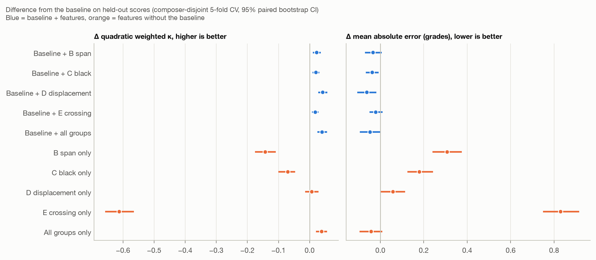
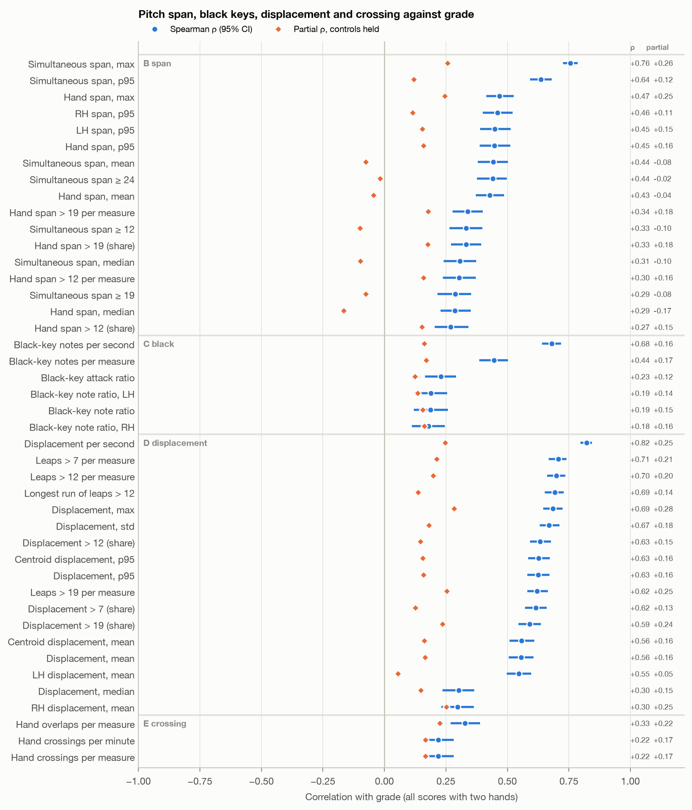

# Pitch span, black keys, displacement and crossing against grade

Generated by `nina_stats/hand_features.py`: groups B–E of `FEATURES_SPEC.md` (group A is in `COORDINATION.md`).
806 scores;
hands were assigned from staves for 796, heuristically for 8 (more than
two staves, a near-empty staff, or a top staff lower than the bottom one) and not at all for 2
(a single staff with notes; their hand features are missing, not zero).

## Does any group add predictive value? (FEATURES_SPEC.md §11)

Ridge regression on quantile-normalised features, rounded to a grade, 5-fold CV with **composer-disjoint** folds
(no composer in both training and test). Baseline = note count, notes per second, stored tempo, written duration
and mean polyphony. Raw counts are left out of the models. 95% CIs bootstrap the held-out scores; Δ is paired
(same resamples for both models). QWK = quadratic weighted κ on grades 1–9.

Baseline: QWK 0.831, MAE 0.736. Best addition: Baseline + D displacement, ΔQWK
+0.042 [+0.028, +0.057]. All groups
together: ΔQWK +0.040 [+0.025,
+0.056], ΔMAE -0.047
[-0.094, -0.001].
With random (not composer-disjoint) folds the baseline gets QWK 0.832 and baseline + all
groups 0.873.

Composer-disjoint folds:

| Model | Features | QWK | Bal. acc9 | Acc ±1 | MAE | ΔQWK vs baseline | ΔMAE vs baseline |
|---|---|---|---|---|---|---|---|
| Baseline (5 controls) | 5 | 0.831 [0.808, 0.852] | 0.393 [0.354, 0.435] | 0.857 [0.833, 0.881] | 0.736 [0.680, 0.790] | – | – |
| Baseline + B span | 44 | 0.854 [0.833, 0.872] | 0.395 [0.357, 0.438] | 0.887 [0.864, 0.909] | 0.702 [0.650, 0.753] | +0.023 [+0.010, +0.036] | -0.033 [-0.071, +0.006] |
| Baseline + C black | 14 | 0.851 [0.829, 0.870] | 0.402 [0.363, 0.443] | 0.886 [0.865, 0.906] | 0.699 [0.649, 0.748] | +0.020 [+0.009, +0.031] | -0.037 [-0.067, -0.007] |
| Baseline + D displacement | 48 | 0.873 [0.855, 0.889] | 0.401 [0.361, 0.440] | 0.912 [0.892, 0.931] | 0.674 [0.628, 0.722] | +0.042 [+0.028, +0.057] | -0.062 [-0.107, -0.019] |
| Baseline + E crossing | 8 | 0.849 [0.827, 0.868] | 0.390 [0.351, 0.430] | 0.882 [0.859, 0.906] | 0.715 [0.663, 0.766] | +0.018 [+0.008, +0.029] | -0.021 [-0.050, +0.010] |
| Baseline + all groups | 99 | 0.871 [0.852, 0.888] | 0.381 [0.343, 0.417] | 0.919 [0.900, 0.938] | 0.689 [0.645, 0.736] | +0.040 [+0.025, +0.056] | -0.047 [-0.094, -0.001] |
| B span only | 39 | 0.688 [0.654, 0.723] | 0.232 [0.202, 0.264] | 0.751 [0.721, 0.780] | 1.043 [0.980, 1.107] | -0.143 [-0.176, -0.109] | +0.308 [+0.239, +0.375] |
| C black only | 9 | 0.761 [0.729, 0.789] | 0.280 [0.246, 0.315] | 0.795 [0.769, 0.823] | 0.916 [0.861, 0.970] | -0.070 [-0.101, -0.046] | +0.180 [+0.125, +0.243] |
| D displacement only | 43 | 0.838 [0.817, 0.857] | 0.321 [0.284, 0.363] | 0.875 [0.849, 0.898] | 0.794 [0.743, 0.844] | +0.007 [-0.014, +0.029] | +0.058 [-0.001, +0.114] |
| E crossing only | 3 | 0.219 [0.174, 0.261] | 0.113 [0.102, 0.123] | 0.486 [0.454, 0.522] | 1.566 [1.496, 1.633] | -0.612 [-0.657, -0.565] | +0.830 [+0.749, +0.916] |
| All groups only | 94 | 0.870 [0.852, 0.886] | 0.374 [0.336, 0.412] | 0.916 [0.896, 0.934] | 0.694 [0.648, 0.737] | +0.039 [+0.021, +0.057] | -0.042 [-0.096, +0.009] |

Random folds (for comparison; composers leak between training and test):

| Model | Features | QWK | Bal. acc9 | Acc ±1 | MAE | ΔQWK vs baseline | ΔMAE vs baseline |
|---|---|---|---|---|---|---|---|
| Baseline (5 controls) | 5 | 0.832 [0.809, 0.852] | 0.380 [0.342, 0.419] | 0.866 [0.841, 0.888] | 0.733 [0.682, 0.785] | – | – |
| Baseline + B span | 44 | 0.856 [0.836, 0.875] | 0.390 [0.349, 0.428] | 0.893 [0.872, 0.913] | 0.695 [0.645, 0.744] | +0.025 [+0.011, +0.038] | -0.038 [-0.076, -0.002] |
| Baseline + C black | 14 | 0.850 [0.828, 0.869] | 0.383 [0.346, 0.425] | 0.887 [0.866, 0.908] | 0.706 [0.658, 0.756] | +0.018 [+0.006, +0.030] | -0.027 [-0.058, +0.006] |
| Baseline + D displacement | 48 | 0.869 [0.852, 0.884] | 0.372 [0.333, 0.411] | 0.909 [0.890, 0.928] | 0.684 [0.638, 0.728] | +0.037 [+0.022, +0.052] | -0.050 [-0.091, -0.009] |
| Baseline + E crossing | 8 | 0.850 [0.828, 0.869] | 0.380 [0.341, 0.419] | 0.888 [0.866, 0.911] | 0.707 [0.661, 0.757] | +0.018 [+0.007, +0.030] | -0.026 [-0.056, +0.004] |
| Baseline + all groups | 99 | 0.873 [0.856, 0.889] | 0.386 [0.350, 0.424] | 0.917 [0.897, 0.934] | 0.672 [0.628, 0.717] | +0.041 [+0.024, +0.059] | -0.061 [-0.108, -0.010] |
| B span only | 39 | 0.716 [0.683, 0.749] | 0.249 [0.217, 0.282] | 0.770 [0.742, 0.798] | 0.991 [0.932, 1.050] | -0.116 [-0.148, -0.085] | +0.258 [+0.197, +0.324] |
| C black only | 9 | 0.775 [0.743, 0.802] | 0.287 [0.254, 0.325] | 0.808 [0.780, 0.834] | 0.885 [0.829, 0.942] | -0.057 [-0.086, -0.033] | +0.151 [+0.099, +0.210] |
| D displacement only | 43 | 0.838 [0.818, 0.857] | 0.320 [0.284, 0.360] | 0.876 [0.852, 0.898] | 0.782 [0.732, 0.830] | +0.006 [-0.016, +0.028] | +0.048 [-0.009, +0.103] |
| E crossing only | 3 | 0.231 [0.185, 0.274] | 0.113 [0.102, 0.123] | 0.491 [0.458, 0.527] | 1.557 [1.485, 1.624] | -0.601 [-0.649, -0.551] | +0.824 [+0.741, +0.904] |
| All groups only | 94 | 0.874 [0.856, 0.890] | 0.405 [0.367, 0.445] | 0.913 [0.895, 0.931] | 0.666 [0.622, 0.710] | +0.042 [+0.023, +0.060] | -0.067 [-0.118, -0.016] |

## Correlation with grade (FEATURES_SPEC.md §11)

**Partial ρ** ranks the feature and the grade, regresses both on the ranks of the controls and correlates the
residuals: "| notes" holds the note count, "| all controls" holds the five baseline controls. **ρ, printed tempo**
repeats ρ on the 561 scores with a printed metronome mark, for which per-second rates rest
on a reliable tempo; per-measure and per-quarter versions are given for the rest. CIs are 95% bootstrap
over scores.

Strongest beyond the controls (by |partial ρ, all controls|):

- rh_displacement_max: ρ +0.67, partial +0.31
- hand_displacement_centroid_max: ρ +0.69, partial +0.28
- Displacement, max: ρ +0.69, partial +0.28
- rh_displacement_gt19: ρ +0.49, partial +0.26
- lh_pitch_span_max: ρ +0.52, partial +0.26
- rh_displacement_gt12: ρ +0.55, partial +0.26
- Simultaneous span, max: ρ +0.76, partial +0.26
- Leaps > 19 per measure: ρ +0.62, partial +0.25

### B span

| feature | N | ρ [95% CI] | τc | partial ρ | notes | partial ρ | all controls | ρ, printed tempo |
|---|---|---|---|---|---|---|
| simultaneous_pitch_span_mean | 804 | +0.44 [+0.38, +0.50] | +0.34 | +0.08 | -0.08 | +0.41 |
| simultaneous_pitch_span_median | 804 | +0.31 [+0.24, +0.37] | +0.22 | +0.05 | -0.10 | +0.24 |
| simultaneous_pitch_span_std | 804 | +0.57 [+0.52, +0.62] | +0.43 | +0.21 | +0.12 | +0.57 |
| simultaneous_pitch_span_iqr | 804 | +0.32 [+0.25, +0.38] | +0.24 | +0.02 | -0.05 | +0.29 |
| simultaneous_pitch_span_p95 | 804 | +0.64 [+0.59, +0.68] | +0.49 | +0.24 | +0.12 | +0.63 |
| simultaneous_pitch_span_max | 804 | +0.76 [+0.73, +0.79] | +0.61 | +0.37 | +0.26 | +0.76 |
| simultaneous_pitch_span_ge12 | 804 | +0.33 [+0.26, +0.40] | +0.25 | +0.03 | -0.10 | +0.27 |
| simultaneous_pitch_span_ge19 | 804 | +0.29 [+0.22, +0.35] | +0.22 | +0.04 | -0.08 | +0.26 |
| simultaneous_pitch_span_ge24 | 804 | +0.44 [+0.38, +0.50] | +0.33 | +0.11 | -0.02 | +0.43 |
| hand_pitch_span_mean | 804 | +0.43 [+0.37, +0.49] | +0.32 | +0.03 | -0.04 | +0.35 |
| hand_pitch_span_median | 804 | +0.29 [+0.23, +0.35] | +0.18 | -0.02 | -0.17 | +0.20 |
| hand_pitch_span_std | 804 | +0.50 [+0.45, +0.55] | +0.38 | +0.12 | +0.16 | +0.42 |
| hand_pitch_span_iqr | 804 | +0.42 [+0.36, +0.48] | +0.30 | +0.04 | -0.01 | +0.31 |
| hand_pitch_span_p95 | 804 | +0.45 [+0.39, +0.51] | +0.31 | +0.09 | +0.16 | +0.39 |
| hand_pitch_span_max | 804 | +0.47 [+0.41, +0.53] | +0.35 | +0.16 | +0.25 | +0.45 |
| hand_pitch_span_gt12 | 804 | +0.27 [+0.20, +0.34] | +0.19 | +0.10 | +0.15 | +0.24 |
| hand_pitch_span_gt19 | 804 | +0.33 [+0.27, +0.39] | +0.17 | +0.14 | +0.18 | +0.37 |
| hand_pitch_span_gt24 | 804 | +0.28 [+0.23, +0.35] | +0.11 | +0.14 | +0.16 | +0.31 |
| rh_pitch_span_mean | 804 | +0.41 [+0.35, +0.47] | +0.31 | +0.05 | +0.05 | +0.39 |
| rh_pitch_span_median | 804 | +0.19 [+0.13, +0.26] | +0.12 | -0.02 | -0.05 | +0.19 |
| rh_pitch_span_std | 804 | +0.49 [+0.44, +0.55] | +0.38 | +0.11 | +0.14 | +0.46 |
| rh_pitch_span_iqr | 804 | +0.38 [+0.32, +0.44] | +0.27 | +0.06 | +0.05 | +0.31 |
| rh_pitch_span_p95 | 804 | +0.46 [+0.40, +0.52] | +0.33 | +0.07 | +0.11 | +0.43 |
| rh_pitch_span_max | 804 | +0.50 [+0.44, +0.55] | +0.37 | +0.14 | +0.20 | +0.47 |
| rh_pitch_span_gt12 | 804 | +0.25 [+0.18, +0.32] | +0.15 | +0.05 | +0.11 | +0.23 |
| rh_pitch_span_gt19 | 804 | +0.26 [+0.20, +0.31] | +0.09 | +0.10 | +0.06 | +0.26 |
| rh_pitch_span_gt24 | 804 | +0.20 [+0.14, +0.25] | +0.05 | +0.09 | +0.05 | +0.20 |
| lh_pitch_span_mean | 804 | +0.34 [+0.28, +0.40] | +0.26 | +0.04 | -0.08 | +0.24 |
| lh_pitch_span_median | 804 | +0.24 [+0.18, +0.30] | +0.16 | -0.02 | -0.18 | +0.08 |
| lh_pitch_span_std | 804 | +0.47 [+0.41, +0.53] | +0.35 | +0.15 | +0.16 | +0.43 |
| lh_pitch_span_iqr | 804 | +0.34 [+0.28, +0.40] | +0.24 | +0.05 | -0.02 | +0.25 |
| lh_pitch_span_p95 | 804 | +0.45 [+0.39, +0.51] | +0.32 | +0.13 | +0.15 | +0.38 |
| lh_pitch_span_max | 804 | +0.52 [+0.46, +0.57] | +0.39 | +0.20 | +0.26 | +0.51 |
| lh_pitch_span_gt12 | 804 | +0.33 [+0.26, +0.40] | +0.22 | +0.15 | +0.17 | +0.32 |
| lh_pitch_span_gt19 | 804 | +0.29 [+0.23, +0.34] | +0.13 | +0.13 | +0.20 | +0.33 |
| lh_pitch_span_gt24 | 804 | +0.25 [+0.19, +0.31] | +0.08 | +0.12 | +0.17 | +0.28 |
| large_hand_span_attacks_gt12 (count) | 804 | +0.39 [+0.33, +0.45] | +0.27 | +0.11 | +0.16 | +0.36 |
| large_hand_span_attacks_per_measure_gt12 | 804 | +0.30 [+0.24, +0.37] | +0.21 | +0.11 | +0.16 | +0.27 |
| large_hand_span_attacks_gt19 (count) | 804 | +0.35 [+0.29, +0.41] | +0.18 | +0.13 | +0.17 | +0.38 |
| large_hand_span_attacks_per_measure_gt19 | 804 | +0.34 [+0.28, +0.40] | +0.17 | +0.14 | +0.18 | +0.37 |
| large_hand_span_attacks_gt24 (count) | 804 | +0.29 [+0.23, +0.35] | +0.11 | +0.14 | +0.16 | +0.32 |
| large_hand_span_attacks_per_measure_gt24 | 804 | +0.29 [+0.23, +0.35] | +0.11 | +0.14 | +0.16 | +0.31 |

### C black

| feature | N | ρ [95% CI] | τc | partial ρ | notes | partial ρ | all controls | ρ, printed tempo |
|---|---|---|---|---|---|---|
| black_key_notes (count) | 804 | +0.70 [+0.66, +0.74] | +0.55 | +0.15 | +0.15 | +0.68 |
| black_key_note_ratio | 804 | +0.19 [+0.12, +0.26] | +0.14 | +0.11 | +0.15 | +0.20 |
| black_key_note_ratio_rh | 804 | +0.18 [+0.11, +0.25] | +0.14 | +0.11 | +0.16 | +0.20 |
| black_key_note_ratio_lh | 804 | +0.19 [+0.12, +0.25] | +0.14 | +0.10 | +0.14 | +0.20 |
| black_key_attack_ratio | 804 | +0.23 [+0.16, +0.29] | +0.17 | +0.09 | +0.12 | +0.22 |
| black_key_attack_ratio_rh | 804 | +0.24 [+0.17, +0.30] | +0.18 | +0.10 | +0.14 | +0.25 |
| black_key_attack_ratio_lh | 804 | +0.19 [+0.13, +0.26] | +0.15 | +0.07 | +0.10 | +0.17 |
| black_key_notes_per_second | 804 | +0.68 [+0.64, +0.72] | +0.54 | +0.38 | +0.16 | +0.67 |
| black_key_notes_per_measure | 804 | +0.44 [+0.39, +0.50] | +0.34 | +0.20 | +0.17 | +0.46 |
| black_key_notes_per_quarter | 804 | +0.50 [+0.44, +0.55] | +0.39 | +0.25 | +0.15 | +0.48 |

### D displacement

| feature | N | ρ [95% CI] | τc | partial ρ | notes | partial ρ | all controls | ρ, printed tempo |
|---|---|---|---|---|---|---|
| hand_displacement_semitones_mean | 804 | +0.56 [+0.51, +0.61] | +0.43 | +0.28 | +0.16 | +0.56 |
| hand_displacement_semitones_median | 804 | +0.30 [+0.24, +0.36] | +0.22 | +0.16 | +0.15 | +0.34 |
| hand_displacement_semitones_std | 804 | +0.67 [+0.63, +0.71] | +0.53 | +0.31 | +0.18 | +0.68 |
| hand_displacement_semitones_iqr | 804 | +0.58 [+0.53, +0.62] | +0.44 | +0.23 | +0.08 | +0.58 |
| hand_displacement_semitones_p95 | 804 | +0.63 [+0.58, +0.67] | +0.49 | +0.29 | +0.16 | +0.64 |
| hand_displacement_semitones_max | 804 | +0.69 [+0.65, +0.72] | +0.55 | +0.31 | +0.28 | +0.72 |
| hand_displacement_semitones_gt7 | 804 | +0.62 [+0.57, +0.66] | +0.48 | +0.29 | +0.13 | +0.62 |
| hand_displacement_semitones_gt12 | 804 | +0.63 [+0.59, +0.68] | +0.49 | +0.27 | +0.15 | +0.64 |
| hand_displacement_semitones_gt19 | 804 | +0.59 [+0.55, +0.64] | +0.43 | +0.28 | +0.24 | +0.62 |
| rh_displacement_mean | 804 | +0.30 [+0.23, +0.36] | +0.22 | +0.22 | +0.25 | +0.32 |
| rh_displacement_median | 804 | +0.12 [+0.05, +0.19] | +0.08 | +0.15 | +0.20 | +0.16 |
| rh_displacement_std | 804 | +0.52 [+0.47, +0.57] | +0.40 | +0.25 | +0.24 | +0.53 |
| rh_displacement_iqr | 804 | +0.33 [+0.27, +0.39] | +0.25 | +0.12 | +0.15 | +0.35 |
| rh_displacement_p95 | 804 | +0.44 [+0.38, +0.50] | +0.33 | +0.23 | +0.22 | +0.45 |
| rh_displacement_max | 804 | +0.67 [+0.63, +0.71] | +0.53 | +0.31 | +0.31 | +0.70 |
| rh_displacement_gt7 | 804 | +0.40 [+0.34, +0.46] | +0.31 | +0.21 | +0.20 | +0.42 |
| rh_displacement_gt12 | 804 | +0.55 [+0.50, +0.60] | +0.42 | +0.27 | +0.26 | +0.58 |
| rh_displacement_gt19 | 804 | +0.49 [+0.44, +0.54] | +0.32 | +0.23 | +0.26 | +0.52 |
| lh_displacement_mean | 804 | +0.55 [+0.50, +0.60] | +0.42 | +0.22 | +0.05 | +0.54 |
| lh_displacement_median | 804 | +0.45 [+0.39, +0.51] | +0.34 | +0.17 | +0.02 | +0.44 |
| lh_displacement_std | 804 | +0.66 [+0.62, +0.70] | +0.52 | +0.30 | +0.16 | +0.65 |
| lh_displacement_iqr | 804 | +0.59 [+0.54, +0.64] | +0.45 | +0.25 | +0.07 | +0.57 |
| lh_displacement_p95 | 804 | +0.61 [+0.56, +0.66] | +0.48 | +0.27 | +0.13 | +0.62 |
| lh_displacement_max | 804 | +0.68 [+0.64, +0.72] | +0.54 | +0.27 | +0.21 | +0.69 |
| lh_displacement_gt7 | 804 | +0.60 [+0.56, +0.64] | +0.46 | +0.26 | +0.06 | +0.60 |
| lh_displacement_gt12 | 804 | +0.61 [+0.56, +0.65] | +0.46 | +0.23 | +0.08 | +0.61 |
| lh_displacement_gt19 | 804 | +0.56 [+0.51, +0.61] | +0.40 | +0.24 | +0.17 | +0.57 |
| hand_displacement_centroid_mean | 804 | +0.56 [+0.51, +0.61] | +0.43 | +0.28 | +0.16 | +0.57 |
| hand_displacement_centroid_median | 804 | +0.31 [+0.24, +0.37] | +0.22 | +0.16 | +0.16 | +0.35 |
| hand_displacement_centroid_std | 804 | +0.67 [+0.63, +0.71] | +0.53 | +0.31 | +0.18 | +0.68 |
| hand_displacement_centroid_iqr | 804 | +0.58 [+0.53, +0.62] | +0.44 | +0.23 | +0.08 | +0.57 |
| hand_displacement_centroid_p95 | 804 | +0.63 [+0.58, +0.67] | +0.49 | +0.29 | +0.16 | +0.64 |
| hand_displacement_centroid_max | 804 | +0.69 [+0.65, +0.72] | +0.55 | +0.31 | +0.28 | +0.72 |
| hand_displacement_centroid_gt7 | 804 | +0.61 [+0.57, +0.66] | +0.47 | +0.28 | +0.11 | +0.62 |
| hand_displacement_centroid_gt12 | 804 | +0.63 [+0.60, +0.68] | +0.49 | +0.26 | +0.12 | +0.65 |
| hand_displacement_centroid_gt19 | 804 | +0.59 [+0.55, +0.64] | +0.44 | +0.29 | +0.23 | +0.62 |
| large_hand_leaps_gt7 (count) | 804 | +0.79 [+0.76, +0.82] | +0.65 | +0.30 | +0.18 | +0.80 |
| large_hand_leaps_per_measure_gt7 | 804 | +0.71 [+0.67, +0.74] | +0.57 | +0.41 | +0.21 | +0.72 |
| large_hand_leaps_gt12 (count) | 804 | +0.76 [+0.73, +0.79] | +0.61 | +0.29 | +0.18 | +0.77 |
| large_hand_leaps_per_measure_gt12 | 804 | +0.70 [+0.66, +0.74] | +0.55 | +0.35 | +0.20 | +0.71 |
| large_hand_leaps_gt19 (count) | 804 | +0.66 [+0.62, +0.70] | +0.49 | +0.28 | +0.25 | +0.68 |
| large_hand_leaps_per_measure_gt19 | 804 | +0.62 [+0.58, +0.67] | +0.46 | +0.31 | +0.25 | +0.65 |
| longest_large_leap_run_gt12 | 804 | +0.69 [+0.65, +0.73] | +0.53 | +0.28 | +0.14 | +0.72 |
| hand_displacement_per_second | 804 | +0.82 [+0.80, +0.84] | +0.69 | +0.60 | +0.25 | +0.83 |
| hand_displacement_per_measure | 804 | +0.63 [+0.58, +0.67] | +0.50 | +0.36 | +0.23 | +0.67 |
| hand_displacement_per_quarter | 804 | +0.69 [+0.65, +0.72] | +0.55 | +0.44 | +0.23 | +0.68 |

### E crossing

| feature | N | ρ [95% CI] | τc | partial ρ | notes | partial ρ | all controls | ρ, printed tempo |
|---|---|---|---|---|---|---|
| hand_crossing_count (count) | 804 | +0.22 [+0.16, +0.28] | +0.07 | +0.10 | +0.17 | +0.26 |
| hand_overlap_count (count) | 804 | +0.33 [+0.27, +0.39] | +0.16 | +0.17 | +0.22 | +0.39 |
| hand_crossing_per_measure | 804 | +0.22 [+0.15, +0.28] | +0.07 | +0.10 | +0.17 | +0.26 |
| hand_crossing_per_minute | 804 | +0.22 [+0.15, +0.28] | +0.07 | +0.10 | +0.17 | +0.26 |
| hand_overlap_per_measure | 804 | +0.33 [+0.27, +0.39] | +0.16 | +0.17 | +0.22 | +0.38 |

## Per-measure table

`results/hand_features_per_measure.csv`: 58053 rows (one per measure of the 804
scores with two hands): `notes`, `simultaneous_span_max`, `hand_span_max`, `hand_spans_gt12`, `black_key_notes`, `displacement_sum`, `displacement_max`, `leaps_gt12`, `crossings`, plus the measure's start, length in quarters and
seconds at the stored tempo. A transition between attacks belongs to the measure of the second attack. The sums over
measures equal the piece totals (checked on every run).

## Definitions

- Notes are attacks only (no grace notes, no tied continuations). Onsets are exact fractions of a quarter note
  (tuplets kept exact) and grouped by equality.
- **Simultaneous span**: highest − lowest pitch struck at one onset, both hands together (not a hand stretch).
  **Hand span**: the same within one hand. Shares are over onset groups; "per measure" counts groups.
- **Black key**: sounding pitch class in {1, 3, 6, 8, 10}. Note ratio counts notes; attack ratio counts a
  hand's onset groups with at least one black key.
- **Displacement**: |change| of the median pitch between a hand's successive onset groups (centroid: mean
  pitch), pooled over both hands and per hand. Per second uses the written duration at the stored tempo.
- **Crossing**: an onset where the LH median pitch is above the RH median; **overlap**: LH top note above RH
  bottom note. Both are proxies.
- Every distribution feature has mean, median, std, IQR, p95 and max; raw counts are separate columns marked
  "(count)".
