# Dataset statistics (sections 3.5–3.7)

Generated by `nina_stats/analyze.py` from the dataset sheet, `results/content.csv` (`extract.py`, one parse of
every MusicXML), `labels/` (composer and score classification) and the existing model results. All 806 scores
unless a section says otherwise; "560" is the subset with a metronome mark used in `model_comparison`.

## 3.5 Repertoire composition

### Composers and concentration

505 distinct composer strings (after the sheet's own name normalization) for 806 scores; 429
(85%) appear once. The top composer, Yohei Kato, has 129 scores
(16.0%); the top 10 hold 27.0% and the top 50 40.3%.
Herfindahl index 0.029 (effective number of equally represented composers 35); Gini 0.36.
Without Yohei Kato the HHI is 0.0042
(effective number 238).

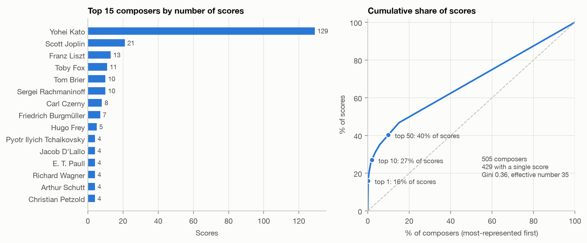

Composer × grade: every composer with at least 3 scores, sorted by mean grade; composers with fewer scores are
pooled in the bottom rows. Cells count scores (colour on a square-root-like scale so that small counts stay
visible next to Yohei Kato).

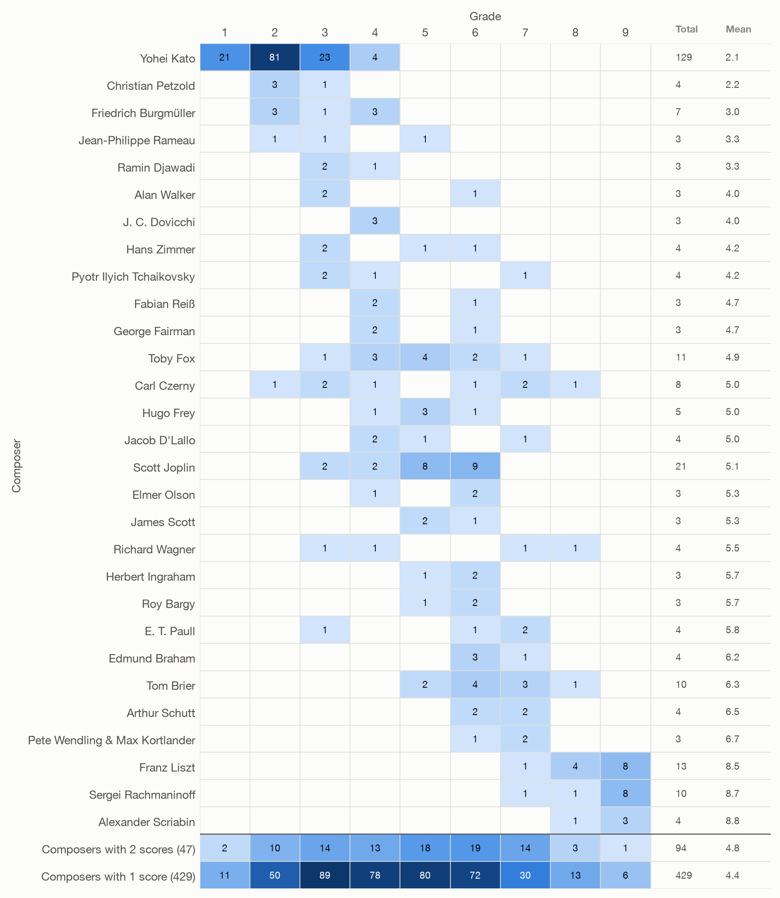

### Era

Era of the composer's main activity (for an arrangement, the original composer). Bars show the number of scores,
split by grade bucket; the label gives the mean grade.

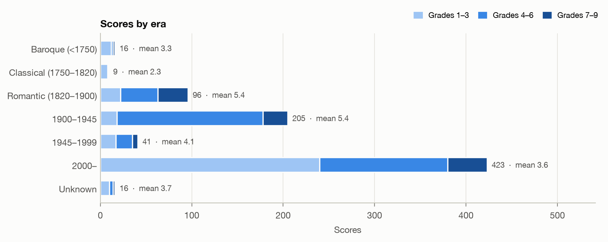

| Era | Scores | Composers | Mean grade |
|---|---|---|---|
| Baroque (<1750) | 16 | 9 | 3.31 |
| Classical (1750–1820) | 9 | 9 | 2.33 |
| Romantic (1820–1900) | 96 | 53 | 5.44 |
| 1900–1945 | 205 | 136 | 5.38 |
| 1945–1999 | 41 | 36 | 4.15 |
| 2000– | 423 | 247 | 3.65 |
| Unknown | 16 | 15 | 3.69 |

### Genre and form

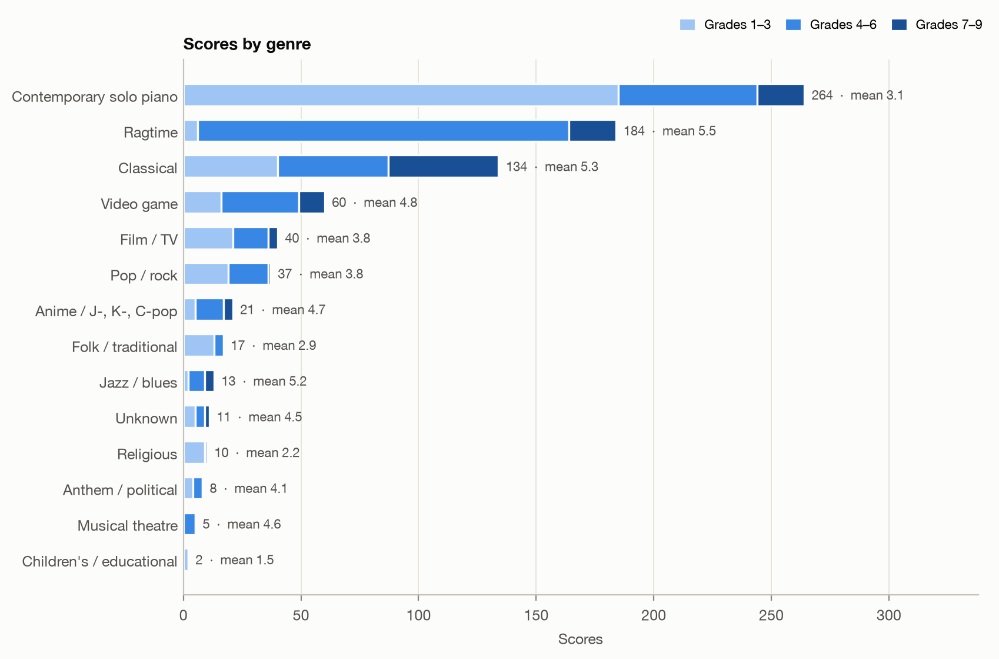

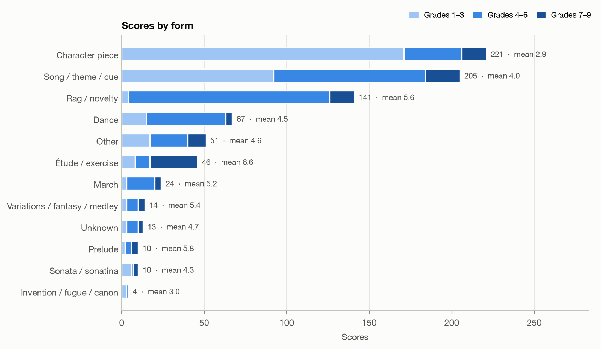

| Genre | Scores | Mean grade |
|---|---|---|
| Anime / J-, K-, C-pop | 21 | 4.67 |
| Anthem / political | 8 | 4.12 |
| Children's / educational | 2 | 1.5 |
| Classical | 134 | 5.28 |
| Contemporary solo piano | 264 | 3.14 |
| Film / TV | 40 | 3.82 |
| Folk / traditional | 17 | 2.94 |
| Jazz / blues | 13 | 5.23 |
| Musical theatre | 5 | 4.6 |
| Pop / rock | 37 | 3.76 |
| Ragtime | 184 | 5.47 |
| Religious | 10 | 2.2 |
| Unknown | 11 | 4.55 |
| Video game | 60 | 4.8 |

### Original works, arrangements and simplified versions

A score counts as an **arrangement** when its music was originally written for other forces (song, orchestra,
opera, film or game soundtrack) and as a **simplified version** when it is an easier or reduced version of an
existing piece (marked easy/simplified/beginner, or clearly reduced; this includes easy arrangements of songs).
551 scores (68%) are original piano works,
224 (28%) arrangements,
16 (2%) simplified versions and 15 unknown.
Simplification is the least certain label: 62 further scores (counted above by their
original medium) are short arrangements, mostly of pop, game and film music, that may or may not be reduced, so
2% is a lower bound.
Simplified versions are rated lower (mean grade 2.56 vs.
4.36 for originals).

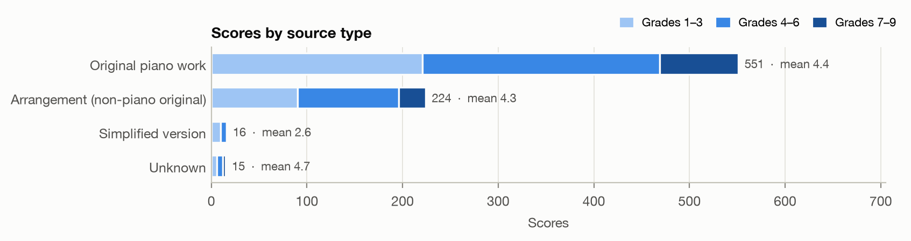

| Genre / source | Original piano work | Arrangement (non-piano original) | Simplified version | Unknown |
|---|---|---|---|---|
| Contemporary solo piano | 259 | 2 | 0 | 3 |
| Ragtime | 176 | 5 | 3 | 0 |
| Classical | 104 | 26 | 4 | 0 |
| Video game | 1 | 57 | 0 | 2 |
| Film / TV | 0 | 36 | 4 | 0 |
| Pop / rock | 0 | 35 | 1 | 1 |
| Anime / J-, K-, C-pop | 0 | 21 | 0 | 0 |
| Folk / traditional | 1 | 14 | 1 | 1 |
| Jazz / blues | 8 | 5 | 0 | 0 |
| Unknown | 0 | 3 | 0 | 8 |
| Religious | 0 | 8 | 2 | 0 |
| Anthem / political | 1 | 7 | 0 | 0 |
| Musical theatre | 0 | 5 | 0 | 0 |
| Children's / educational | 1 | 0 | 1 | 0 |

### Composer gender (fairness check)

Gender is filled only where it is documented for the (original) composer; names alone were not used, so the
245 undocumented composers (mostly MuseScore users and obscure names) stay unknown. Composers:
227 male, 25 female, 8 mixed teams, 245 unknown.
Scores: 507 male (63%), 30 female (3.7%),
9 mixed, 260 unknown.
Mean grade: male 4.17, female 4.63 (Mann–Whitney p = 0.097).
Yohei Kato alone accounts for 129 of the 507 male-composer scores (this composer's gender is
not source-checked; see `labels/composers.csv`). Without them: 378 male (56%),
30 female (4.4%), 260 unknown, mean grade male
4.89.

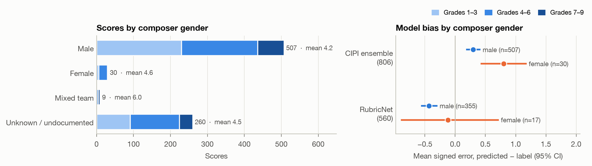

Grade distribution by gender:

| Gender / grade | 1 | 2 | 3 | 4 | 5 | 6 | 7 | 8 | 9 |
|---|---|---|---|---|---|---|---|---|---|
| Male | 27 | 115 | 88 | 62 | 68 | 76 | 37 | 14 | 20 |
| Female | 0 | 3 | 3 | 7 | 7 | 9 | 1 | 0 | 0 |
| Mixed team | 0 | 0 | 0 | 1 | 3 | 0 | 5 | 0 | 0 |
| Unknown / undocumented | 7 | 31 | 53 | 48 | 44 | 41 | 19 | 11 | 6 |

Model error by gender (negative = the model underrates):

| Model | Gender | N | Mean signed error | MAE | Exact |
|---|---|---|---|---|---|
| CIPI ensemble (806) | male | 507 | +0.30 [+0.19, +0.40] | 0.92 | 0.373 |
| CIPI ensemble (806) | female | 30 | +0.80 [+0.43, +1.17] | 0.93 | 0.367 |
| RubricNet (560) | male | 355 | -0.43 [-0.55, -0.31] | 0.93 | 0.321 |
| RubricNet (560) | female | 17 | -0.12 [-0.88, +0.71] | 1.41 | 0.176 |

Within genre (genres with at least 3 female-composer scores; CIPI ensemble error = predicted − label):

| Genre | N female | N male | Mean grade female | Mean grade male | CIPI error female | CIPI error male |
|---|---|---|---|---|---|---|
| Anime / J-, K-, C-pop | 3 | 9 | 3.67 | 5.11 | 1.0 | 0.44 |
| Classical | 4 | 117 | 5.75 | 5.32 | 0.25 | -0.21 |
| Film / TV | 3 | 32 | 3.0 | 4.06 | 1.33 | 0.66 |
| Pop / rock | 3 | 22 | 4.67 | 3.91 | 1.67 | 0.77 |
| Ragtime | 12 | 119 | 5.33 | 5.45 | 0.67 | 0.88 |
| Video game | 4 | 30 | 3.25 | 4.37 | 0.25 | 0.1 |

The female group is small, so the intervals are wide, and it is concentrated in ragtime and pop; read
differences within genre rather than overall.

## 3.6 Score content statistics

### Length and tempo by grade

Check of the existing sentence (560 scores with a metronome mark, RubricNet's IOI tempo): median note count
154 at grade 1 → 3448 at grade 9, median IOI tempo
35 → 338 onsets per minute; monotonic:
notes True, IOI tempo True.

All 806 scores: median note count 152 → 3800
(monotonic: True); median IOI tempo 36 →
322 (monotonic: True); onsets per minute at the stored
playback tempo 68 → 513
(monotonic: True).

Definitions:
- **IOI tempo** = 60 / mean inter-onset interval in seconds, averaged over both hands (RubricNet's descriptors,
  as in `model_comparison`). RubricNet reads the 246 scores without a metronome mark
  at 100 bpm, so on the full set this column is partly at an assumed tempo.
- **Onsets per minute (stored tempo)** = distinct note onsets (both hands merged) per minute of written duration,
  using the playback tempo stored in the file (`<sound tempo>`; 805 of 806 files have
  one, the rest play at MuseScore's 120). Spearman with IOI tempo: 0.83 (all), 0.93 (560).
- **Duration** = written length at the stored tempo; repeats and D.C./D.S. are not unfolded
  (45% of scores have repeat signs or jumps), so it is a lower bound on performance time.
  Median 110 s; IQR 77–157 s.
- **Polyphony** = notes sounding at each onset (all staves), averaged over onsets. **Voices** = most
  `<voice>`s holding notes on one staff in one measure. **Chord span** = pitch spread of notes struck together on
  one staff (95th percentile per score; % > octave = share of such chords wider than 12 semitones).
- Pitch range is over all notes; pitch entropy is the Shannon entropy of MIDI pitches (pitch-class entropy over
  the 12 classes is in the table).

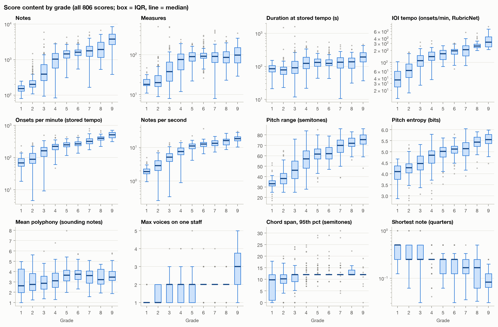

Medians per grade (all 806; `multivoice_measures` and `chords_over_octave` are means of per-score shares):

| Grade | N | notes | measures | seconds | ioi_tempo | onsets_min | notes_sec | pitch_range | pitch_entropy | pc_entropy | polyphony | max_polyphony | voices_max | multivoice_measures | chord_span_p95 | chords_over_octave | shortest |
|---|---|---|---|---|---|---|---|---|---|---|---|---|---|---|---|---|---|
| 1 | 34 | 152 | 18 | 85 | 36 | 68 | 1.89 | 33 | 4.1 | 2.88 | 2.62 | 4.0 | 1.0 | 9.0% | 10 | 6.8% | eighth |
| 2 | 149 | 200 | 20 | 78 | 63 | 88 | 2.85 | 38 | 4.27 | 2.9 | 2.76 | 4.0 | 1.0 | 20.3% | 10 | 3.6% | 16th |
| 3 | 144 | 391 | 38 | 91 | 112 | 162 | 5.12 | 46 | 4.46 | 2.89 | 2.86 | 5.0 | 2.0 | 17.5% | 12 | 2.9% | 16th |
| 4 | 118 | 1030 | 76 | 124 | 141 | 224 | 7.56 | 57 | 4.84 | 2.99 | 3.12 | 6.0 | 2.0 | 13.8% | 12 | 4.4% | 16th |
| 5 | 122 | 1448 | 89 | 132 | 166 | 250 | 10.99 | 62 | 5.02 | 3.1 | 3.65 | 7.0 | 2.0 | 12.7% | 12 | 3.1% | 16th |
| 6 | 126 | 1616 | 91 | 123 | 196 | 265 | 12.59 | 62 | 5.12 | 3.19 | 3.75 | 7.0 | 2.0 | 11.9% | 12 | 2.1% | 16th |
| 7 | 62 | 1770 | 90 | 134 | 210 | 318 | 13.36 | 70 | 5.13 | 3.06 | 3.6 | 7.0 | 2.0 | 12.0% | 12 | 4.4% | 16th |
| 8 | 25 | 1935 | 86 | 138 | 259 | 398 | 15.9 | 72 | 5.44 | 3.33 | 3.22 | 8.0 | 2.0 | 21.9% | 12 | 4.0% | 16th |
| 9 | 26 | 3800 | 98 | 193 | 322 | 513 | 18.13 | 76 | 5.54 | 3.43 | 3.46 | 10.0 | 3.0 | 39.2% | 12 | 2.7% | 32nd |

### Time and key signatures

399 scores (50%) start in 4/4; 88% start in 4/4, 2/4, 3/4
or 2/2. 12% change time signature, 36%
change key signature and 17% have more than one stored tempo. Key signatures stay
close to C: 67% have at most two sharps or flats (the mode is rarely
encoded, so major and minor are not separated). Score 792 has no time signature.

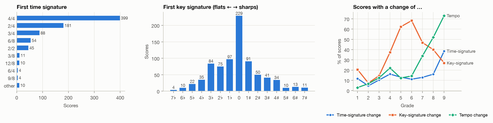

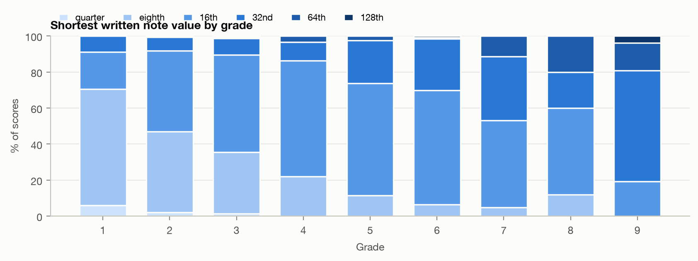

The shortest written note is a 16th in 53% of scores; Spearman between grade
and the shortest note value (rank, quarter = 0 … 128th = 5) is 0.47.

### Notation markings

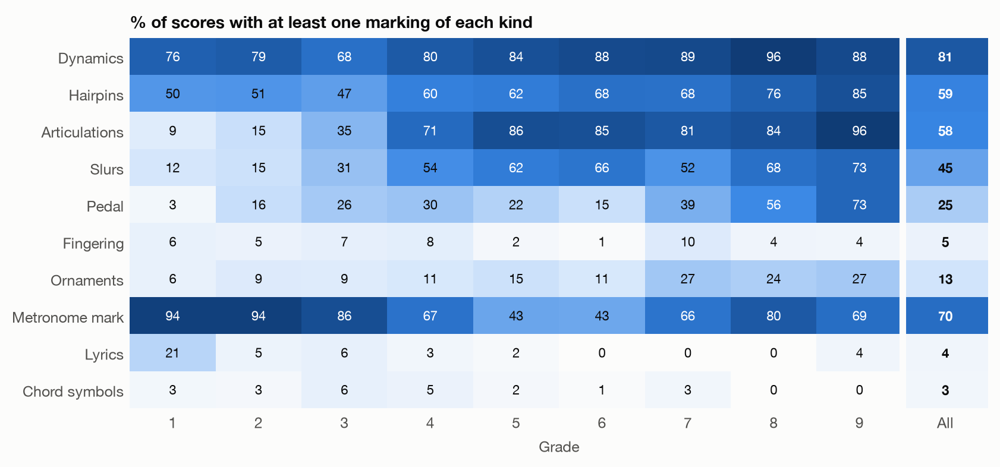

| Marking | Scores with ≥1 | % | Median count where present | Spearman with grade |
|---|---|---|---|---|
| Dynamics | 651 | 81% | 7 | 0.47 |
| Hairpins | 476 | 59% | 5 | 0.31 |
| Articulations | 469 | 58% | 51 | 0.60 |
| Slurs | 361 | 45% | 28 | 0.40 |
| Pedal | 201 | 25% | 19 | 0.19 |
| Fingering | 41 | 5% | 52 | -0.04 |
| Ornaments | 104 | 13% | 6 | 0.14 |
| Metronome mark | 561 | 70% | 1 | -0.18 |
| Lyrics | 30 | 4% | 104 | -0.16 |
| Chord symbols | 26 | 3% | 34 | -0.05 |

Fingering is rarely annotated (5% of scores).
Lyrics appear in 30 scores (song arrangements that kept the words).

### Piano key usage

Note attacks per key of the 88-key keyboard (A0–C8, MIDI 21–108; tied continuations and grace notes left out;
middle C = C4 = MIDI 60). All 88 keys are played somewhere in the dataset and no note falls outside the keyboard.
The most played key is C4 (3.48% of all attacks), followed by
G3, C5, G4, D5. The three octaves C3–B5 hold 80% of all attacks. Black keys
take 32.3% of attacks (5 of 12 keys per octave would be 41.7% if all keys were equally used). 10 keys
appear in fewer than 5% of scores: A0–B0 at the
bottom and F♯7–C8 at the top.

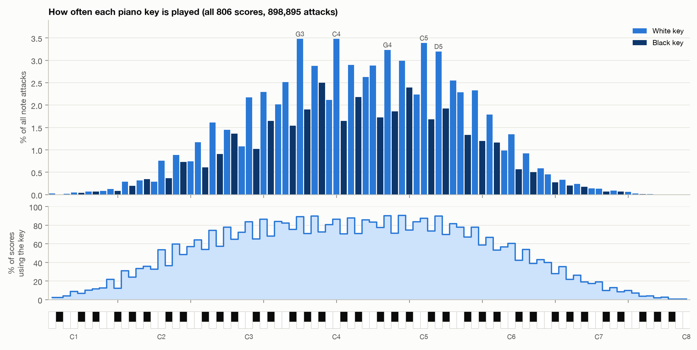

| Key | MIDI | % of attacks | % of scores using it |
|---|---|---|---|
| C4 | 60 | 3.48 | 86.4 |
| G3 | 55 | 3.48 | 89.3 |
| C5 | 72 | 3.39 | 87.6 |
| G4 | 67 | 3.23 | 90.3 |
| D5 | 74 | 3.2 | 90.0 |
| A4 | 69 | 2.99 | 90.7 |
| D4 | 62 | 2.89 | 88.0 |
| F4 | 65 | 2.88 | 83.5 |
| A3 | 57 | 2.88 | 89.8 |
| E4 | 64 | 2.62 | 85.7 |
| E5 | 76 | 2.55 | 81.8 |
| F3 | 53 | 2.52 | 82.4 |
| A♯3 | 58 | 2.5 | 72.8 |
| A♯4 | 70 | 2.4 | 74.9 |
| G5 | 79 | 2.33 | 78.0 |

The range widens with grade, mostly upwards: the central 90% of attacks spans B2–E5
at grade 1 and E2–F♯6 at grade 9; the bottom reaches
D♯2 by grade 5 and moves little after that, while the top keeps rising.
The share of black-key attacks doubles, from 21% at grade 1 to 42% at grade 9 (each
row of the heatmap sums to 100%):

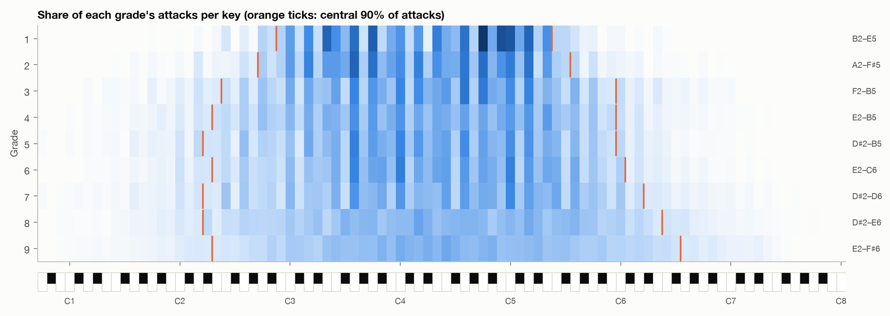

| Grade | Central 90% of attacks | Keys in it | % black-key attacks |
|---|---|---|---|
| 1 | B2–E5 | 30 | 21.4 |
| 2 | A2–F♯5 | 34 | 26.0 |
| 3 | F2–B5 | 43 | 27.4 |
| 4 | E2–B5 | 44 | 31.0 |
| 5 | D♯2–B5 | 45 | 29.0 |
| 6 | E2–C6 | 45 | 31.0 |
| 7 | D♯2–D6 | 48 | 34.0 |
| 8 | D♯2–E6 | 50 | 41.1 |
| 9 | E2–F♯6 | 51 | 42.5 |

Pitch classes, from most to least played: C 11.3%, G 11.3%, D 10.4%, A 9.7%, F 9.5%, E 8.7%, A♯ 8.0%, D♯ 7.1%, B 6.9%, G♯ 6.3%, F♯ 5.6%, C♯ 5.4%.
Harder pieces use more black keys and spread more evenly over the 12 classes.

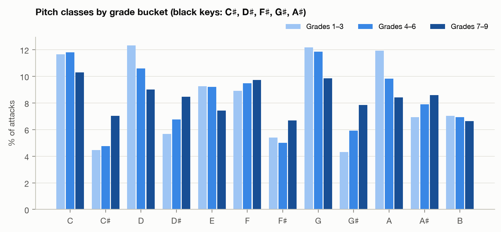

Per-score counts are in `results/key_counts.csv`.

## 3.7 Confounds and correlations

### Length

On all 806 scores, Spearman between note count and grade is **0.80**
(Kendall τc **0.67**) and for measure count 0.65
(τc 0.50). On the 560-score subset: note count ρ 0.82
/ τc 0.68, measure count ρ 0.67 / τc
0.51. CIPI reports τc = 0.48 for length against grade, so length is a
stronger confound here than in CIPI. Duration at the stored tempo: ρ 0.41, τc
0.30.

τc is Stuart's tau-c (`scipy.stats.kendalltau(variant="c")`), the variant CIPI uses for an ordinal label with many
ties; it is always smaller than ρ for the same data, so compare τc with τc. CIs are 95% bootstrap percentile
intervals over scores (1000 resamples). "Partial ρ" is Spearman with note count partialled out (linear on
ranks), i.e. what a feature says about the grade beyond length.

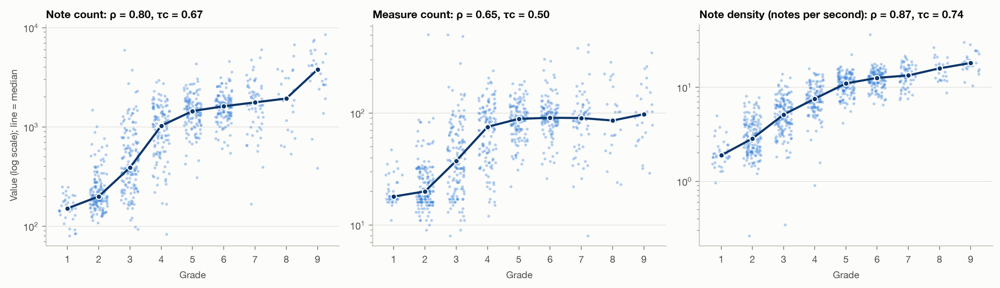

### Note density

Notes per second at the stored tempo is the single strongest correlate of grade: ρ
0.87, τc
0.74; partial ρ with note count held fixed
0.63. Notes per measure: ρ
0.66, τc 0.52. IOI tempo (RubricNet): ρ
0.76 (all 806) and 0.83 (560; lower on all 806
because RubricNet reads unmarked scores at 100 bpm). Density stays strongly related to grade with length held fixed,
whereas duration and measure count turn negative: at a given note count, harder pieces are shorter and denser.

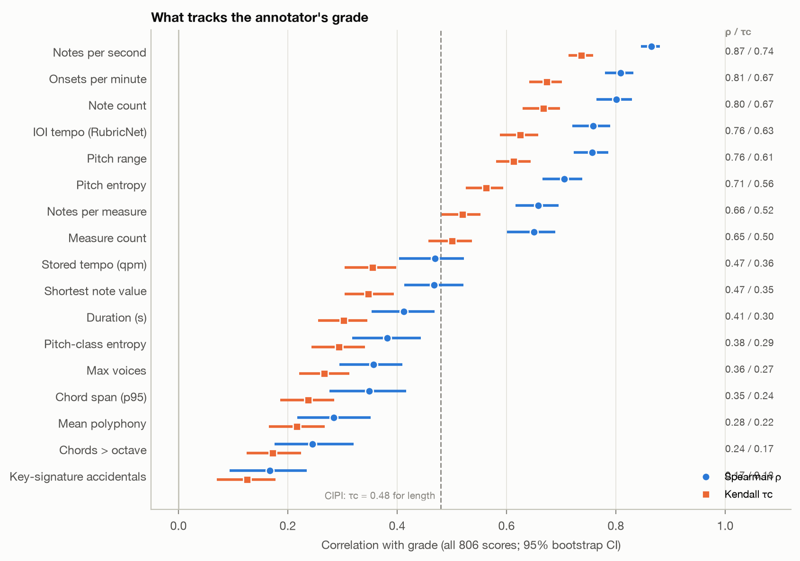

All features, all 806 scores:

| Feature | N | Spearman ρ [95% CI] | Kendall τc [95% CI] | Partial ρ, note count held |
|---|---|---|---|---|
| Note count | 806 | 0.80 [0.76, 0.83] | 0.67 [0.63, 0.70] | – |
| Measure count | 806 | 0.65 [0.60, 0.69] | 0.50 [0.46, 0.54] | -0.19 |
| Duration (s) | 806 | 0.41 [0.35, 0.47] | 0.30 [0.26, 0.35] | -0.49 |
| Notes per second | 806 | 0.87 [0.85, 0.88] | 0.74 [0.71, 0.76] | 0.63 |
| Notes per measure | 806 | 0.66 [0.62, 0.70] | 0.52 [0.48, 0.55] | 0.30 |
| IOI tempo (RubricNet) | 806 | 0.76 [0.72, 0.79] | 0.63 [0.59, 0.66] | 0.55 |
| Onsets per minute | 806 | 0.81 [0.78, 0.83] | 0.67 [0.64, 0.70] | 0.60 |
| Stored tempo (qpm) | 806 | 0.47 [0.40, 0.52] | 0.36 [0.30, 0.40] | 0.24 |
| Pitch range | 806 | 0.76 [0.72, 0.79] | 0.61 [0.58, 0.64] | 0.39 |
| Pitch entropy | 806 | 0.71 [0.67, 0.74] | 0.56 [0.53, 0.59] | 0.34 |
| Pitch-class entropy | 806 | 0.38 [0.32, 0.44] | 0.29 [0.24, 0.34] | 0.15 |
| Mean polyphony | 806 | 0.28 [0.22, 0.35] | 0.22 [0.17, 0.27] | -0.02 |
| Max voices | 806 | 0.36 [0.29, 0.41] | 0.27 [0.22, 0.31] | 0.15 |
| Chord span (p95) | 806 | 0.35 [0.28, 0.42] | 0.24 [0.19, 0.28] | 0.12 |
| Chords > octave | 806 | 0.24 [0.18, 0.32] | 0.17 [0.12, 0.22] | 0.10 |
| Shortest note value | 806 | 0.47 [0.41, 0.52] | 0.35 [0.30, 0.39] | 0.23 |
| Key-signature accidentals | 806 | 0.17 [0.09, 0.23] | 0.13 [0.07, 0.18] | 0.10 |

The 560-score subset (length and tempo features):

| Feature | N | Spearman ρ | Kendall τc |
|---|---|---|---|
| Note count | 560 | 0.82 | 0.68 |
| Measure count | 560 | 0.67 | 0.51 |
| Duration (s) | 560 | 0.4 | 0.29 |
| Notes per second | 560 | 0.88 | 0.75 |
| Notes per measure | 560 | 0.65 | 0.51 |
| IOI tempo (RubricNet) | 560 | 0.83 | 0.7 |
| Onsets per minute | 560 | 0.83 | 0.69 |

### Composer identity (the memorisation floor)

A predictor that only knows who wrote the piece: the mean grade of the same composer's scores in the training
folds, rounded (5-fold CV, same folds as the note-count baseline). A composer with no training scores falls back
to the majority grade or to the note-count baseline. 356 of 806 scores (44%) have their
composer in the training folds; 429 composers have a single score and can never be memorised.

Among composers with ≥ 2 scores (377 scores, 76 composers), composer identity explains
η² = 0.83 of the grade variance, ω² = 0.79 after correcting for the many small groups
(Kruskal–Wallis H = 305, p = 2.0e-29). Without Yohei Kato (129 scores, all
grades 1–4):
η² = 0.72, ω² = 0.61.

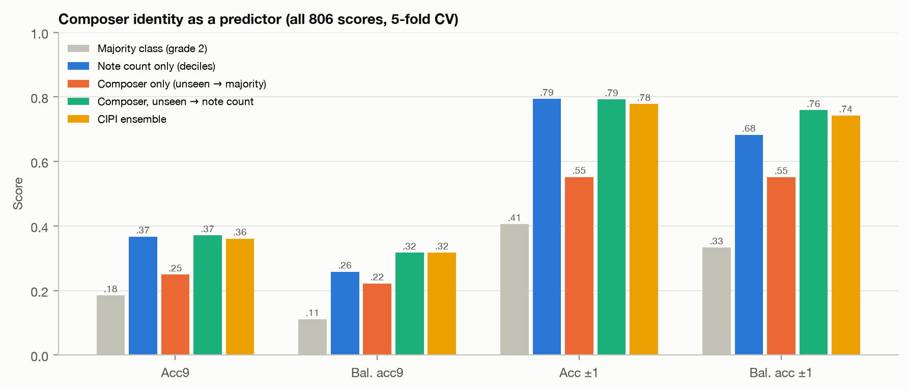

| Predictor | N | Acc9 | Bal. acc9 | Acc ±1 | Bal. acc ±1 | Spearman | MSE |
|---|---|---|---|---|---|---|---|
| Majority class (grade 2) | 806 | 0.185 | 0.111 | 0.406 | 0.333 | – | 9.29 |
| Note count only (deciles) | 806 | 0.367 | 0.258 | 0.794 | 0.683 | 0.787 | 1.609 |
| Composer only (unseen → majority) | 806 | 0.249 | 0.222 | 0.552 | 0.552 | 0.373 | 5.772 |
| Composer, unseen → note count | 806 | 0.371 | 0.317 | 0.793 | 0.759 | 0.76 | 1.659 |
| Composer only, seen composers | 356 | 0.419 | 0.326 | 0.812 | 0.799 | 0.811 | 1.688 |
| Composer only, seen, without Yohei Kato | 227 | 0.3 | 0.307 | 0.722 | 0.716 | 0.571 | 2.383 |
| CIPI ensemble | 806 | 0.361 | 0.318 | 0.778 | 0.743 | 0.831 | 1.632 |
| CIPI ensemble, seen composers | 356 | 0.399 | 0.312 | 0.798 | 0.742 | 0.855 | 1.559 |
| CIPI ensemble, seen, without Yohei Kato | 227 | 0.339 | 0.326 | 0.722 | 0.698 | 0.733 | 2.022 |
| RubricNet (560) | 560 | 0.3 | 0.338 | 0.78 | 0.773 | 0.816 | 1.893 |

On the 356 scores whose composer appears in the training folds, the composer's mean grade
alone gets acc9 0.419 / balanced acc9 0.326 / acc ±1 0.812, against
0.399 / 0.312 / 0.798 for the CIPI ensemble on the same
scores. Much of this is Yohei Kato: without those scores it drops to 0.300 / 0.307 /
0.722 (ensemble 0.339 / 0.326 / 0.722).
Composer mean with the note-count fallback, on all 806 scores, gets 0.371 / 0.317 /
0.793 (ensemble 0.361 / 0.318 / 0.778). This is the
floor a model can reach without reading a note, given random (not composer-disjoint) splits.
